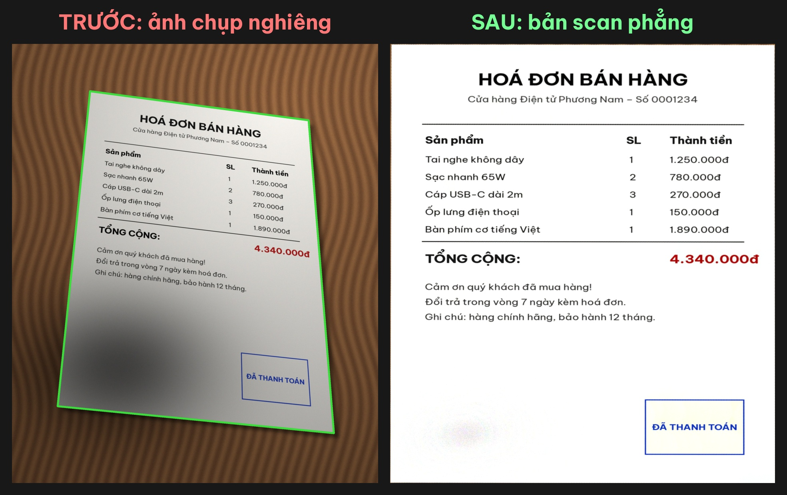
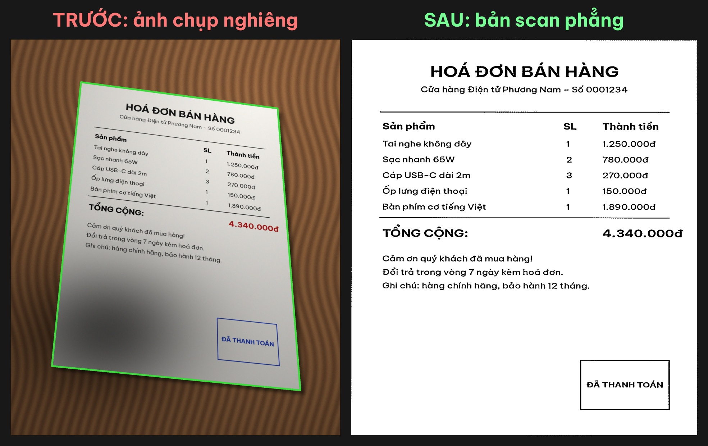

# giayphang 📄✨

**Chụp giấy tờ bằng điện thoại – nghiêng, tối, dính bóng tay – và biến nó thành bản scan phẳng, trắng sạch như máy scan trong chưa đầy 1 giây.**
Chạy hoàn toàn offline trên máy tính, miễn phí, không đăng nhập, không watermark, không gửi ảnh lên server nào.



## Làm được gì?

- 🔍 **Tự tìm 4 góc tờ giấy** trong ảnh (hoá đơn, hợp đồng, bài kiểm tra, giấy tờ tuỳ thân…).
- 📐 **Nắn phẳng phối cảnh**: ảnh chụp xiên thành trang thẳng, đúng tỉ lệ.
- 💡 **Xoá bóng đổ và ánh sáng không đều**: nền giấy trắng tinh, chữ rõ nét.
- 🎨 3 chế độ: `mau` (giữ màu – con dấu đỏ/xanh), `xam` (thang xám), `trangden` (đen trắng sắc nét, nhẹ file nhất).
- 📚 Xử lý nhiều ảnh một lúc và **gộp thành 1 file PDF**.
- 🖼️ Xuất **ảnh so sánh trước/sau** có nhãn tiếng Việt – tiện quay video, đăng mạng xã hội.

## Cài đặt

Cần Python 3.10 trở lên.

```bash
git clone https://github.com/vietphan98/giayphang.git
cd giayphang
python -m venv .venv
source .venv/bin/activate        # Windows: .venv\Scripts\activate
pip install -e .
```

## Cách dùng

```bash
# 1 ảnh, chế độ giữ màu (mặc định), kèm ảnh so sánh trước/sau
giayphang hoa_don.jpg --so-sanh

# Đen trắng sắc nét
giayphang hop_dong.jpg -m trangden

# Nhiều trang -> gộp 1 file PDF
giayphang trang1.jpg trang2.jpg trang3.jpg -m xam --pdf hop_dong.pdf

# Đổi thư mục lưu kết quả (mặc định: ket_qua/)
giayphang anh.jpg -o thu_muc_khac
```

Hoặc chạy không cần cài: `python -m giayphang anh.jpg --so-sanh`.

Dùng trong code Python:

```python
import cv2
from giayphang import scan

img = cv2.imread("hoa_don.jpg")
ket_qua, goc = scan(img, mode="trangden")   # goc = 4 góc tờ giấy (hoặc None)
cv2.imwrite("hoa_don_scan.png", ket_qua)
```

## 🎬 Demo nhanh (quay Reel 20–30 giây)

```bash
python examples/tao_anh_mau.py                       # tạo ảnh hoá đơn chụp nghiêng trên bàn gỗ, có bóng tay
giayphang examples/hoa_don_chup_nghieng.jpg --so-sanh  # < 1 giây
giayphang examples/hoa_don_chup_nghieng.jpg -m trangden --so-sanh --pdf ket_qua/hoa_don.pdf
```

Kịch bản quay gợi ý:
1. (0–5s) Chụp một tờ hoá đơn bằng điện thoại, cố tình chụp nghiêng, có bóng tay.
2. (5–12s) Kéo ảnh vào máy, gõ một lệnh `giayphang anh.jpg --so-sanh`.
3. (12–25s) Mở ảnh `ket_qua/..._truoc_sau_mau.jpg`: bên trái ảnh xiên tối, bên phải bản scan thẳng tắp, trắng tinh.
4. (25–30s) Mở file PDF đã gộp.

Kết quả chế độ đen trắng:



**Câu hook gợi ý cho Reel:** *"Đừng trả tiền app scan nữa – chụp nghiêng cỡ nào, 1 giây là thành bản scan phẳng lì như máy photocopy!"*

## Mẹo chụp để kết quả đẹp nhất

- Đặt giấy trên nền **tối hơn hoặc khác màu** giấy (bàn gỗ, bàn đen…).
- Để thấy **đủ 4 góc** tờ giấy trong khung hình.
- Nếu không tìm được viền giấy, tool vẫn làm sạch ánh sáng cho toàn bộ ảnh và báo cho bạn biết.

## Cách hoạt động (ngắn gọn)

1. Thu nhỏ ảnh, làm mờ và "đóng hình thái" để xoá chữ, chỉ còn khối tờ giấy.
2. Tìm đường viền (Canny + Otsu), chọn tứ giác lồi lớn nhất → 4 góc.
3. Biến đổi phối cảnh (perspective transform) về hình chữ nhật.
4. Ước lượng nền giấy bằng phép đóng + lọc trung vị rồi chia ảnh cho nền → xoá bóng đổ.
5. Tuỳ chế độ: tăng tương phản màu, chuẩn hoá xám hoặc ngưỡng thích nghi đen trắng.

## Giấy phép

- Mã nguồn: [MIT](LICENSE) © 2026 Viet Phan.
- Font **Be Vietnam Pro** đi kèm (để hiển thị đúng dấu tiếng Việt) dùng giấy phép SIL Open Font License – xem `giayphang/fonts/OFL.txt`.
